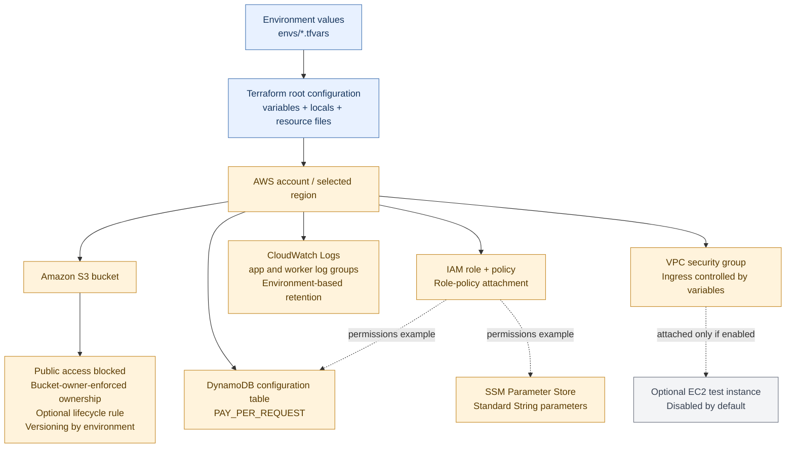

# Architecture

## Overview

This project uses one flat Terraform root configuration to define a small AWS infrastructure baseline. The selected environment is controlled by `envs/dev.tfvars`, `envs/staging.tfvars`, or `envs/prod.tfvars`; the resource definitions are shared across environments.

> **Deployment scope:** Apply **dev only**, plan staging and production without applying them, and destroy dev resources after verification. The diagram describes the resources defined by the configuration when enabled; it does not claim they are currently running.

## Architecture diagram

The dotted arrows from IAM represent the example permissions relationship, not network traffic. The security group is a network control; it does not create an EC2 instance.

## Resource inventory

| Resource                     | Terraform file      | Purpose                                                                         |
| ---------------------------- | ------------------- | ------------------------------------------------------------------------------- |
| S3 bucket                    | `s3.tf`             | Application/configuration bucket with public access blocked.                    |
| S3 ownership controls        | `s3.tf`             | Enforces bucket-owner ownership for objects.                                    |
| S3 versioning                | `s3.tf`             | Controlled by `enable_versioning`; disabled in dev and enabled in staging/prod. |
| S3 lifecycle configuration   | `s3.tf`             | Optional expiration rule for objects.                                           |
| DynamoDB table               | `dynamodb.tf`       | Configuration table using on-demand `PAY_PER_REQUEST` billing.                  |
| IAM role, policy, attachment | `iam.tf`            | Demonstrates an application role and scoped access policy.                      |
| SSM parameters               | `ssm.tf`            | Creates standard-tier `String` parameters from the configured map.              |
| CloudWatch log groups        | `cloudwatch.tf`     | Creates log groups with configured retention periods.                           |
| Security group               | `security-group.tf` | Security group in the default VPC; ingress is controlled by configured CIDRs.   |
| Optional EC2 instance        | `ec2-optional.tf`   | Controlled by `enable_ec2_test_instance`; disabled by default.                  |

## Environment behavior

| Environment | Intended workflow            | Main settings                                                           |
| ----------- | ---------------------------- | ----------------------------------------------------------------------- |
| `dev`       | Plan, apply, verify, destroy | S3 versioning disabled; EC2 disabled.                                   |
| `staging`   | Plan only                    | S3 versioning enabled; EC2 disabled.                                    |
| `prod`      | Plan only                    | S3 versioning enabled; EC2 disabled; production-specific tags/settings. |

The `prevent_destroy` input does not itself enforce Terraform deletion protection. Terraform's `lifecycle.prevent_destroy` meta-argument must be configured statically rather than from a normal input variable. Do not use this configuration to manage production resources without implementing and reviewing the intended protection.

## Naming and tags

`locals.tf` centralizes environment abbreviations, region abbreviations, the resource naming prefix (including the project's unique suffix), and common tags. Resource names are composed from variables and locals so the same root configuration can be reused across environments.

## State and deployment boundary

The `.tfvars` files change input values but do not automatically isolate Terraform state. This assignment applies only dev; staging and production are plan-only. Before deploying multiple environments independently, configure separate state files or another deliberate state-isolation strategy.

`backend-example.tf` is an example only. Do not enable a remote backend until its S3 bucket, permissions, region, and locking approach are deliberately configured.
